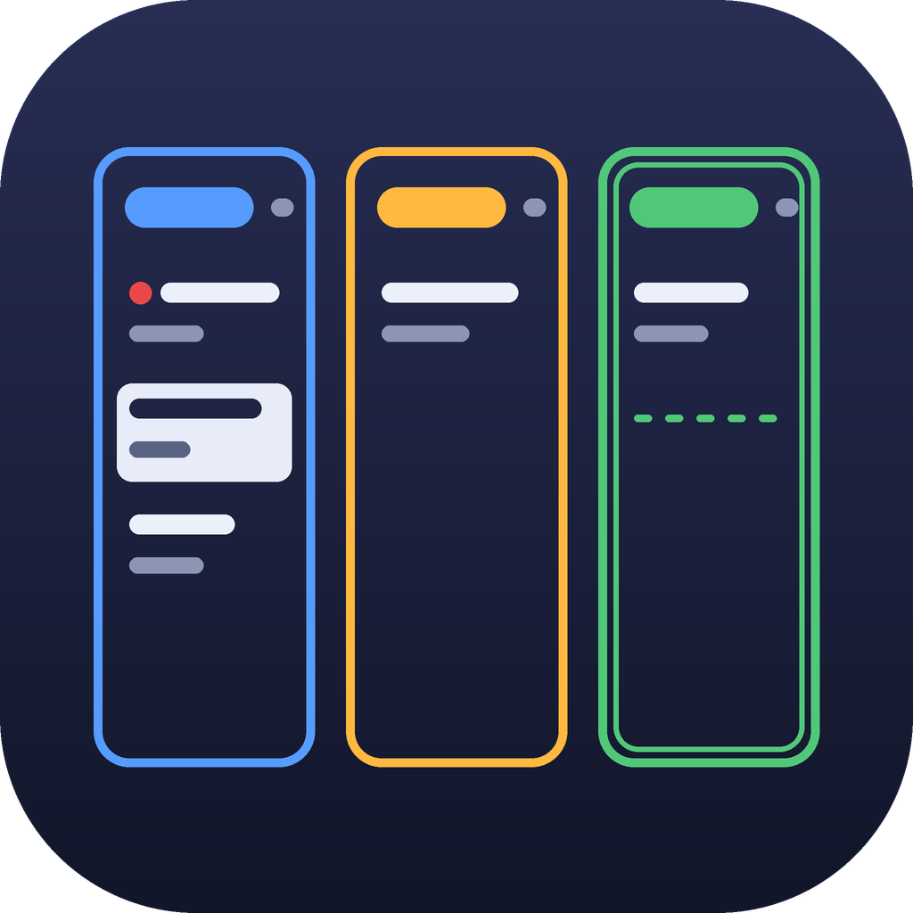

# backlog-pane

**English** · [Español](README.es.md)

A live [Backlog.md](https://github.com/MrLesk/Backlog.md) board in a Claude Code side pane.

> **Unofficial.** backlog-pane is a community mod for Claude Code. It is not part of,
> endorsed by, or maintained by the Backlog.md project or Anthropic. It only drives the
> `backlog` CLI you already have installed.

`/backlog` opens a pane beside the conversation with your tasks in one column per status.
The pane stays in sync with `backlog task list --json --watch`, so it updates when Claude,
you or your teammates change a task. Drag a card to move it, or open a task to edit its
title, priority, acceptance criteria, description and plan. **Work on this task** and
**Edit with Claude** put a ready-made prompt in the prompt box. The prompt is **never sent
for you**.

## Features

- **Live board.** On the terminal and the desktop app, one column per status in your
  configured order, headed by the status as a chip in its colour. Each card is a box
  bordered in its status's colour, with its title (on two lines if it needs them), its ID
  and its criteria done; a card moved to another column takes that column's colour. Drag
  a card to another column to move it, or use the keyboard (see [Shortcuts](#shortcuts)). The final
  status (usually *Done*) shows only its most recent tasks. VS Code and mobile show the
  same tasks as a list grouped by status, with the final status folded.
- **Statuses, from the pane.** **Statuses…** lists every status with its task count. There
  you add one and pick where it goes, delete one that no task is in, pick each status's
  colour, and tick **Closed** for statuses such as *Cancelled*. Closed ones are drawn dim
  and folded like the final status, and ◀/▶ and the board's arrow keys skip them; you can
  still move a task there with the status picker or by dragging.
- **Colours that follow your theme.** Statuses use theme colours, so they suit light and
  dark themes. Unless you pick one, the first status, an *In Progress* one, and the final
  one each have their own, and the others take turns. High-priority tasks get a **`!`** in the error colour,
  so the meaning does not depend on colour alone.
- **New task.** **+ New task** opens a title field. **Cancel** closes it, and it closes by
  itself once the task is created.
- **Move a task.** In the task view, **◀ previous status** and **next status ▶** (keys `h`
  and `l`) move it one step, on every surface. The status picker jumps anywhere.
- **Edit a task.** Title, priority (from `backlog config get priorities`, else
  High/Medium/Low), and acceptance criteria. You can tick, add, edit, and delete criteria;
  delete asks first.
- **Long text.** Edit the description and the implementation plan in a field of several
  lines (Claude Code 2.1.301 and later), or in your own editor on older versions (see
  [Editing long text](#editing-long-text)).
- **Work on this task** drafts this prompt, using the task's real ID (whatever your
  project's prefix is):

  ```text
  Work on BL-7 only. Research the codebase and write an implementation plan in the task. Wait for my approval before coding.
  ```

- **Edit with Claude** drafts `Update BL-7: ` with the caret after it, ready for you to say
  what should change.

  Both drafts replace an empty prompt box. If the box already holds text, the draft goes
  below it. Nothing is submitted.
- **Redmine sync.** **Integration…** links the project to a Redmine project, read only
  or both ways. Issues become tasks and stay in step field by field, with a button and
  every few minutes. See [Integration (Redmine)](#integration-redmine).
- **English and Spanish.** The pane, the command and both drafts. See the `language`
  option.
- **CLI only, with one exception.** Every change to a task runs a `backlog` command
  (`task edit`, `task create`); the mod never edits the task files. Backlog.md has no
  command that changes the list of statuses, so creating or deleting one rewrites only the
  `statuses:` line of Backlog.md's config (see [Statuses](#statuses)).
- **Clear errors.** The pane tells you, with a **Retry** button, when the CLI is not
  installed, the folder has no Backlog.md project, or the live list keeps failing.

## Shortcuts

Give the pane the keyboard with `ctrl+x` then `tab`, or click it. Tab moves between
controls and Esc returns to the prompt.

| Where | Key or action | What it does |
| --- | --- | --- |
| Board (terminal, desktop) | Drag a card to another column | Moves the task there. |
| Board (terminal, desktop) | Click a card, then a free spot in another column | Moves the selected card there. |
| Board | Click the selected card again | Opens the task. |
| Board | Click a free spot | Lets go of the selected card. A card you moved with the mouse is let go of by itself, so a later click can't move it again. |
| Board, after a click on it | `←` / `→` | Moves the selected card to the next open column left or right, skipping closed ones. |
| Board, after a click on it | `↑` / `↓` | Selects the card above or below. The first key selects the first card of the first open column. |
| Board, after a click on it | `Enter` | Opens the selected task. |
| Board | `Esc` | Gives the keyboard back. |
| Task view | `h` | Moves the task to the previous open status (◀). |
| Task view | `l` | Moves the task to the next open status (▶). |
| Multi-line field | `Enter` | Saves. |
| Multi-line field | `Shift+Enter`, or `\` then `Enter` | Starts a new line. |

`h` and `l` work while the pane has the keyboard, not while you type in the prompt box.

## Statuses

Statuses belong to each project: Backlog.md keeps them in its config (`backlog/config.yml`,
or `backlog.config.yml` / `.backlog/config.yml`). The pane reads them with
`backlog config get statuses` and draws the columns in that order. The last one is the
final ("done") status, the same rule Backlog.md uses.

**Statuses…** (beside **+ New task**) opens a list of them:

- **Add one:** pick its **Position** (at the start, or after any status; by default before
  the final one), type its name and press Enter. A name can't be empty, repeat another
  (whatever the case), hold a comma, a quote or a line break, or pass 40 characters.
- **Delete one:** **Delete** shows only beside a status no task is in, and asks first.
  The status new tasks start in (`backlog config get defaultStatus`) is kept, and a project
  always keeps at least two.

Backlog.md has no command for this, so the pane:

1. finds the config as Backlog.md does, from the session's folder up;
2. rewrites only its `statuses:` line, every other line left as it was;
3. runs `backlog config get statuses`, and if Backlog.md does not read exactly the new list,
   puts the file back as it was and says so.

Each row also has:

- **Colour:** one of the theme's colours (Blue, Steel blue, Teal, Green, Amber, Orange,
  Red, Purple, Lavender, Grey), or **Automatic** for the one the pane would give it. The
  status's chip, its cards' borders and its swatch take it at once. Mobile cycles through
  them with a button.
- **Closed:** a closed status is folded and dim, and ◀/▶ and the board's arrow keys skip
  it. The final status is always final, so it has no box.

Colours and closed statuses are kept **per project**, in Claude Code's own store for the
mod (keyed by the project's config file), because Backlog.md's config has no place for
them. They are yours alone: they are not in the repository, so teammates don't share
them, and a project moved to another folder starts afresh. The `closedStatuses` option
(below) is only the starting value for a project where no **Closed** box was ever ticked.

## Integration (Redmine)

Each project can be linked to **one** outside tracker. Redmine is the first; Jira and Excel
come next. The tasks are copied into Backlog.md with the `backlog` CLI, so the board,
Claude and Backlog.md's own tools all see them as ordinary tasks.

**Set it up:**

1. Get your API key in Redmine (**My account → API access key**; the server must have
   *Enable REST web service* on).
2. Put it in the plugin's **Redmine API key** option (`/plugin`, or `/config` when the mod
   loads from a folder). It is a sensitive option, so Claude Code keeps it in secure
   storage, not in `settings.json`.
3. In the pane, press **Integration…**, pick **Redmine** as the tracker, and type the
   server's URL (`https://redmine.example.com`) and the project's identifier (as in its
   URL, for example `my-app`).
4. Pick the **Mode**, which **Issues** (all of the project, or only those assigned to
   you) and how often to **Sync**, then **Sync now**.

**Modes:**

- **Read only (Redmine → Backlog.md)**, the default: nothing is ever written to Redmine.
  A field changed in Redmine overwrites the task's. A change you make only in Backlog.md
  stays there, until Redmine changes that field.
- **Both ways:** a field changed on one side is copied to the other. New Backlog.md tasks
  are created in Redmine too, and get the new issue's URL in their references.

**What syncs:** every issue of the project, open and closed, not its subprojects'; or, with
**Only those assigned to me**, just the ones assigned to the API key's owner (you, or a
group you are in). For each
one, the title (subject), status, priority and description. Each new task gets the issue's
URL (`…/issues/42`) in its references, which is how the pane finds the pair again; a task
you already pointed at an issue that way is adopted instead of copied twice, with
Redmine's values winning.

**Status and priority mappings.** After the first sync, **Integration…** lists each
Redmine status and priority with the Backlog.md one it lands in. The pane guesses them
(same name first; then closed ones in the final status, *In Progress*-like ones in yours,
the rest in the first status; *Urgent*/*High* → High, *Normal* → Medium, *Low* → Low) and
you change any of them. A priority set to **— (left alone)** is not synced. In both-ways
mode, a Backlog.md status that no Redmine one maps to is not sent, and the pane says so.

**Conflicts.** The pane keeps what both sides agreed at the last sync. When the same field
changed on both sides, to different values, neither side is touched for that field: the
board shows *1 conflict*, and **Integration…** shows both values with **Use Redmine's** and
**Use Backlog.md's**.

**View: all / only mine.** Beside **Sync now** on the board, a button switches the view at
once, with no call to Redmine: *only mine* hides the tasks whose issue, at the last sync,
was assigned to someone else, to nobody, or was not listed; tasks with no issue always
show. It is separate from the **Issues** option, which decides what is synced: you can
sync every issue and still look at yours only. The view is kept per project.

**When:** **Sync now** in **Integration…** or on the board's sync line, and on its own every
5, 15, 30 or 60 minutes (5 by default), or **Only with the button**. The sync runs only
while the pane is open; the first one starts when it opens.

**Nothing is deleted** on either side. An issue that was deleted, moved out of the
project, or (with *only mine*) assigned to someone else leaves its task as it was, no
longer synced; it syncs again if it comes back. With *only mine* in both-ways mode, a new
Backlog.md task is created in Redmine assigned to you, so it stays in your list. **Disconnect** (tracker **None**) stops the sync and
keeps the tasks.

**Tasks from before.** In both-ways mode, the tasks that were in the project when you set
Redmine up are not sent to it, so linking a project does not flood Redmine. **Send them
too** sends them.

Settings, links and mappings are kept **per project** in Claude Code's store for the mod,
like the colours, so they are yours alone. The key is per user: one key for every project
you sync, sent only in the `X-Redmine-API-Key` header to the URL each project sets.

### Keeping the API key safe

The mod never shows the key to Claude: it is not in the prompt, the conversation, the
pane (which only says whether it is set), the tasks or the mod's store. But Claude Code
keeps it on your machine, and Claude has tools that read files:

- **macOS** keeps it in the Keychain, which asks before a program reads it.
- **Windows and Linux** keep it in `~/.claude/.credentials.json`, a plain file guarded
  only by your user's permissions. Claude would need your approval to read it (it is
  outside the project), unless a permission mode approves everything for you.

To close that door:

1. **Deny reading it**, in `~/.claude/settings.json`. Deny rules win over every
   permission mode:

   ```json
   {
     "permissions": {
       "deny": ["Read(~/.claude/.credentials.json)", "Bash(*credentials.json*)"]
     }
   }
   ```

   The `Read` rule is the one that matters; the `Bash` one only catches the plain cases.
2. **Give the key only the rights it needs.** Use a Redmine user whose role can only view
   issues if you sync read only, so a leaked key can change nothing.
3. **Regenerate it** in Redmine (**My account → API access key**) if you think it leaked.
   The old one stops working at once.

## Editing long text

**Claude Code 2.1.301 and later:** **Edit** beside *Description* or *Implementation plan*
opens an 8-row field. Enter saves with `backlog task edit <id> -d …` or `--plan …`.

**Older versions:** `Input` has no `rows` there, and a drawing that asks for one can be
refused or drawn as a one-line field. So the pane never asks there, and shows **Open in
editor** instead. It writes the text to a
file in your temp folder (`TMPDIR`, `TEMP` or `TMP`) and opens your editor on it. When the
editor exits, the pane reads the file back and saves it. The editor is the first of:

1. `backlog config get defaultEditor`
2. `VISUAL`
3. `EDITOR`
4. Notepad, on Windows

**The editor must keep running until you close the file**, or the pane reads the file back
before you have typed anything. Terminal editors (`vim`, `nano`) already do that. A GUI
editor needs its wait flag:

```bash
backlog config set defaultEditor "code --wait"
```

The pane waits up to ten minutes. After that the edit is not applied.

## Screenshots

<!-- Replace these with real captures: docs/screenshots/terminal-board.png,
     docs/screenshots/terminal-task.png, docs/screenshots/desktop-board.png -->

_Screenshots are coming. Until then, this is a text preview of the terminal pane:_

```text
[ + New task ] [ Statuses… ]

 Cancelled  1     To Do  1         In Progress  1   Done  2

╭─────────────╮  ╭─────────────╮  ╭─────────────╮  ╭─────────────╮
│ Old export  │  │ ! Rate      │  │ ! Write the │  │ Add login   │
│ idea        │  │   limiting… │  │   JSON str… │  │ page        │
│ TASK-5      │  │ TASK-3      │  │ TASK-1 · 1… │  │ TASK-2      │
╰─────────────╯  ╰─────────────╯  ╰─────────────╯  ╰─────────────╯
                                                   ╭─────────────╮
                                                   │ Dark mode   │
                                                   │ TASK-4      │
                                                   ╰─────────────╯

Drag a card to another column, or click it and press ←/→ to move
it, ↑/↓ to pick another, Enter to open it.
```

_That is the pane docked in a 150-column terminal (Claude Code 2.1.310). On screen each
status is a chip in its colour and each card's border takes its status's colour; the
selected card has a thick border, and the column a card is dragged over shows a dashed
slot where it will land._

## Requirements

- **Claude Code 2.1.295 or later**, with mods: the CLI, or the Code tab of the Claude
  Desktop app. Earlier releases cannot draw the task rows (buttons with children arrived in
  2.1.295). The inline multi-line field needs 2.1.301; before that, the external editor
  stands in. Developed against 2.1.310 and checked with 2.1.296 (see *Development*).
  `plugin.json` has no field for a minimum version, so it is stated here only.
- **Backlog.md CLI** on the machine, with JSON output (`schemaVersion` 1). Tested with
  1.55.3.

  ```bash
  npm i -g backlog.md
  ```

  `bun add -g backlog.md` and `brew install backlog-md` also work.
- A project initialized with `backlog init`. The pane uses the session's working folder.

## Install

At the prompt of a Claude Code terminal session:

```text
/plugin install backlog-pane --marketplace ezmg/backlog-pane
```

Answer `y` to add the marketplace, then choose a scope (user scope is the default).

From a shell:

```bash
claude plugin install backlog-pane --marketplace ezmg/backlog-pane
```

**Claude Desktop (Code tab).** `/plugin` does not run there. Click **+** next to the prompt
box, then **Plugins**, **Add marketplace** with `ezmg/backlog-pane`, then **Add plugin**.
A mod you install from a terminal at the user scope also loads in the desktop app's local
sessions.

## Usage

1. Open a session in a folder that has a Backlog.md project.
2. Run `/backlog`.
3. Drag cards between columns, or click a card twice to open it. On VS Code and mobile,
   tap a task in the list.
4. In a task, change the status, title, priority, criteria, description or plan. Or press
   **Work on this task** or **Edit with Claude**, and review the draft before you press
   Enter.

To close the pane, click its close mark or press `ctrl+x` then `x`. Closing it stops the
`--watch` process.

### Options

| Option | Default | What it does |
| --- | --- | --- |
| `backlogPath` | *(empty)* | Full path to the `backlog` executable. When empty, the mod tries `backlog` on PATH. On Windows it then tries the native binaries npm and bun install globally. |
| `doneLimit` | `5` | How many of the most recent tasks in the final status (and in each closed status) the board shows, and the list shows when that group is unfolded. |
| `closedStatuses` | *(empty)* | Optional. Statuses that start as closed in a project where you have never ticked a **Closed** box in **Statuses…**, separated by commas (for example `Cancelled`). Once you tick or untick one, the project keeps its own list. |
| `redmineApiKey` | *(empty)* | Your Redmine API key, for the projects you link to Redmine in **Integration…**. Sensitive: kept in secure storage, and sent only to the Redmine URL each project sets. |
| `language` | `auto` | `en` (English), `es` (Spanish), or `auto`. With `auto` the mod uses the first of these that is set: Claude Code's `language` setting (free text such as `Español`, `Spanish` or `English`), then `LC_ALL`, `LC_MESSAGES`, `LANG`, then the system locale. If none is set, it uses English. Any language other than Spanish shows English. |

Change them under the plugin's settings in `/plugin`. In a session that loads the mod from
a folder, they appear as rows in `/config`, and are stored in your user settings
(`~/.claude/settings.json`, under `pluginConfigs`), not in the project's.

## Where it works

| Where | What you get |
| --- | --- |
| Terminal (`claude`) | Everything, with the drag-and-drop board. In fullscreen the pane docks beside the transcript from 110 columns; otherwise it opens inline above the prompt. |
| Claude Desktop, Code tab | Everything, with the drag-and-drop board. |
| VS Code, Claude Code extension | Everything except the board: tasks are a list grouped by status. Not tested by hand. |
| Mobile (Remote Control) | Browse tasks; move them with ◀/▶ or one button per status; set priority with buttons; tick and delete criteria; both drafts. Mobile has no text fields, so you can't create tasks, edit titles, add or edit criteria, or edit long text there. |
| `claude -p`, Agent SDK, no surface | `/backlog` answers with the board as text. |

If the board fails to draw on a surface, the pane shows the list there instead, until the
mod reloads.

**Not GitHub Copilot.** backlog-pane is a Claude Code mod: it runs only inside Claude Code,
on the API Claude Code gives mods (the side pane, `/backlog`, the prompt box). GitHub
Copilot has no such API, so the mod does nothing there. The VS Code row above means the
Claude Code extension for VS Code. It can sit beside Copilot in the same VS Code, and the
pane shows only in Claude Code's sessions. To reach your tasks from Copilot, use the MCP
server that Backlog.md itself ships. That is separate from this mod, and it has no pane.

### macOS

The mod has no macOS-specific code. It works in the terminal (`claude`) and in the
desktop app. It has not been tried by hand on a Mac yet: the tests run on Linux. Three
things to know:

- **Finding `backlog`.** In a terminal, `backlog` from `brew install backlog-md` or
  `npm i -g backlog.md` is on PATH. Claude Desktop opened from the Dock may not have
  `/opt/homebrew/bin` (or npm's global folder) on its PATH, and the pane then says the CLI
  was not found. Set `backlogPath` to what `which backlog` prints.
- **An editor, before 2.1.301.** Before Claude Code 2.1.301, the description and plan open in
  your editor (see [Editing long text](#editing-long-text)). macOS has no default for the
  mod to fall back on, so set one, once:

  ```bash
  backlog config set defaultEditor "code --wait"
  ```

  `VISUAL` or `EDITOR` work too. From 2.1.301 on, the text is edited in the pane and no
  editor is needed.
- **Dragging in a terminal** needs Claude Code in fullscreen and a terminal that reports
  the mouse (Terminal.app, iTerm2, Ghostty, kitty, WezTerm). The desktop app needs
  nothing. Where dragging does not take, click the board and use the arrow keys.

## How it works

| Action | Command it runs |
| --- | --- |
| Live list | `backlog task list --json --watch` (one child per pane, stopped on close) |
| Status order | `backlog config get statuses` |
| Priorities | `backlog config get priorities` |
| Task details | `backlog task view <id> --json` |
| Change status (picker, ◀ ▶, board) | `backlog task edit <id> --status <status>` |
| Create / delete a status | Rewrites the `statuses:` line of Backlog.md's config, then checks it with `backlog config get statuses` (the one write outside the CLI) |
| Status new tasks start in | `backlog config get defaultStatus` |
| Create a task | `backlog task create <title>` |
| Rename | `backlog task edit <id> -t <title>` |
| Set priority | `backlog task edit <id> --priority <priority>` |
| Tick / untick a criterion | `backlog task edit <id> --check-ac <n>` / `--uncheck-ac <n>` |
| Add a criterion | `backlog task edit <id> --ac <text>` |
| Delete a criterion | `backlog task edit <id> --remove-ac <n>` |
| Edit a criterion | `backlog task edit <id> --acceptance-criteria <1st> --acceptance-criteria <2nd> …` (the whole list, in order), then `--check-ac <n>` if it was ticked |
| Description / plan | `backlog task edit <id> -d <text>` / `--plan <text>` |
| Editor | `backlog config get defaultEditor`, then the editor on a temp file |
| Redmine: read | `GET /projects/<id>.json`, `/issue_statuses.json`, `/enumerations/issue_priorities.json`, `/issues.json?project_id=<id>&subproject_id=!*&status_id=*` (100 a page), plus `&assigned_to_id=me` for only mine |
| Redmine: copy an issue in | `backlog task create <title> -s <status> --priority <p> -d <text> --ref <issue URL>` |
| Redmine: take a change | `backlog task edit <id> -t … -s … --priority … -d …` (only the fields that changed) |
| Redmine: who you are | `GET /users/current.json?include=groups`, for the view and for assigning new issues |
| Redmine: send a change (both ways) | `PUT /issues/<n>.json` with the fields that changed |
| Redmine: send a new task (both ways) | `POST /issues.json` (with only mine, assigned to you), then `backlog task edit <id> --add-ref <issue URL>` |

The editing commands were checked against Backlog.md 1.55.3. Rewriting the criteria list
keeps the ticks of the criteria whose text did not change.

Commands are started without a shell, with each value passed as its own argument, so text
with quotes, `&`, `$` or newlines is safe. The `--watch` stream is a series of
pretty-printed JSON documents. The mod reassembles them however the output is split. If the
child exits, it is restarted with backoff (1 s, 2 s, 4 s, 8 s). After 5 failures in a row
the pane shows the error and a **Retry** button.

## Known limitations

- **A priority cannot be cleared.** `backlog task edit` sets a priority but has no way to
  remove one, so **None** is offered only while a task has no priority.
- **The external editor must block** until you close the file (`code --wait`, not `code`).
  Editors that return at once leave the text unchanged. On Windows, a `.cmd` launcher
  (such as VS Code's `code`) cannot be started without a shell. Give the full path to the
  `.exe` instead, for example
  `backlog config set defaultEditor "\"C:\Program Files\Microsoft VS Code\Code.exe\" --wait"`.
- The pane waits for the external editor for up to ten minutes, and the temp file stays
  in the temp folder afterwards.
- Board titles take two lines at most, so long ones are cut. With many statuses in a
  narrow pane the columns get narrow (12 cells at least).
- **Statuses:** the pane writes the list in the form `backlog init` uses
  (`statuses: ["To Do", "Done"]`). A list written one item per line becomes that one
  line, and a comment on those lines is lost. Task counts leave out drafts and archived
  tasks, so a status an archived task is in can still be deleted. The pane does not
  reorder or rename existing statuses: edit the config for that.
- **Redmine:** acceptance criteria, the plan, notes, comments, assignees, trackers,
  versions and custom fields are not synced. Descriptions go across as they are, with no
  conversion between Redmine's Textile (or Markdown) and Backlog.md's Markdown. A Redmine
  workflow can refuse a status change; the pane shows Redmine's reason and tries again on
  the next sync. The sync runs only while the pane is open. Jira and Excel are not there yet.
- **Not yet:** plan approval, automatic sync when Claude finishes, milestones and the
  definition of done. Subtasks, dependencies, labels and assignees are not shown.
- The live list covers what `task list` returns, so drafts and archived tasks are not
  shown.
- Statuses and priorities are read when the watch starts. After changing them in the
  config, press **Retry** or reopen the pane.
- The final status counts as "done" because it is last in `statuses`, the same rule
  Backlog.md uses.
- In the terminal's main screen (not fullscreen), the pane opens inline above the prompt
  instead of docking to the side.
- Mobile and headless modes are deliberately minimal (see *Where it works*).
- The mods API is in early access and may change between Claude Code releases.
- **Windows:** if neither `backlog` on PATH nor a global npm/bun install can be started,
  set `backlogPath` to the full path of `backlog.exe`.

## Development

```text
.claude-plugin/plugin.json        manifest and options
.claude-plugin/marketplace.json   makes this repository installable
.claude-plugin/icon.png           the plugin's icon
hooks/register.tsx                command, pane, watch loop and actions
hooks/board.tsx                   the board's Client surface module (terminal, desktop)
hooks/cli.ts                      pure helpers: commands, JSON stream reader, grouping, colours, editor
hooks/sync.ts                     pure sync core: three-way merge per field, the plan of each sync
hooks/redmine.ts                  pure Redmine adapter: URLs, parsing, default mappings, issue bodies
hooks/i18n.ts                     English and Spanish strings, language detection
types/index.d.ts                  the $.state contract, the board's props, Backlog.md shapes
tests/                            claude plugin test suites (fixtures.ts is the fake world, with a fake config;
                                  fake-redmine.ts a Redmine in memory)
```

Run the mod from a working copy for one session:

```bash
git clone https://github.com/ezmg/backlog-pane.git
```

```bash
claude --plugin-dir ./backlog-pane
```

Check it:

```bash
claude plugin validate --strict .
```

```bash
claude plugin test .
```

```bash
tsc -p .
```

`tsc` needs the API types the engine writes to `.claude-plugin/types/` when it loads the mod
from a folder (for example with `--plugin-dir`).

To check an older Claude Code without installing it globally, install it in a temp folder
and run its `claude` from there:

```bash
npm i --prefix /tmp/cc296 @anthropic-ai/claude-code@2.1.296
```

```bash
/tmp/cc296/node_modules/.bin/claude plugin test .
```

The tests run against Claude Code's own test kit, with a simulated `backlog` CLI. They
cover:

- the stream reader, grouping, colours, and every command line;
- language detection and both languages;
- the board's layout, pointer and keys, and the list fallback;
- closed statuses, and creating and deleting statuses (with the config rewrite and its check);
- each status's colour and its **Closed** box, kept per project, and cards taking their status's colour;
- every editing control, the inline field and the external editor;
- both drafts;
- the Redmine sync: the merge, read only and both ways, only mine (synced and viewed), conflicts, mappings, refused
  writes, the timer, a missing or wrong key, a missing project and an unreachable server;
- the missing-CLI, uninitialized, failing-watch and headless states.

They run on the terminal, desktop, VS Code and mobile surfaces where each applies, and give
the same result whatever the machine's language. Under
2.1.296 the six tests that pretend to run on 2.1.301 or later (the inline field) fail, as
expected: that kit does not draw `rows`.

## License

[MIT](LICENSE)
